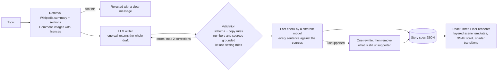

# MythForge

Type a place or a piece of history. MythForge reads the sources, writes a short fact-checked story, and renders it as a cinematic, scroll-driven 3D site.


Everything runs locally on free services: Wikipedia and Wikimedia Commons for sources and images, the Gemini and Groq free tiers (or a local Ollama model) for writing and fact checking.

## Screenshots

| | |
|---|---|
|  |  |
| Kyoto · a temple garden at dusk | Giza · the pyramids at sunset |
|  |  |
| Giza · the Sphinx under a full moon | Giza · a stone barge on the Nile at dawn |
|  |  |
| A generated Mount Everest story on the Peak scene | The homepage over a live, dimmed chapter |
|  |  |
| Generation progress with the real pipeline stages | The gallery with frames captured from each story |

Kyoto and Giza are hand-written example stories. The Everest story was generated end to end from the homepage.

## How it works



1. **Retrieval.** The backend fetches the Wikipedia summary and the most relevant sections (about 1,400 words), plus openly licensed Commons images with author credit. Topics without enough material are rejected before any model call.
2. **Writing.** One LLM call returns the full draft: chapter headings, body copy, a source per chapter, and the scene choice for each chapter (template, art kit, time of day, colours, particles, transition).
3. **Validation.** Pydantic checks the shape, then the copy rules (no em dashes, no contrast-by-negation phrasing, a cliche list, heading length, no numbers in headings), then grounding rules: every number must appear in the source text, every source must be one that was retrieved, landmark art only for its own landmark, and one setting per story. Errors go back to the model for up to two corrections.
4. **Fact check.** A second model, never the one that wrote the story, checks every sentence against the source text. Hedged facts stated as certain count as unsupported. Unsupported sentences get one rewrite; anything still unsupported is removed, and the score is stored with the story.
5. **Rendering.** The frontend only renders the story spec. Each chapter is a layered 3D scene built from a template and a hand-painted art kit, driven by scroll.

## Key engineering decisions

**A template library instead of generated 3D.** Generating scenes from scratch looks inconsistent and is slow. MythForge ships a small set of scene templates (Threshold, Dune, Tide, Peak), each with painted art kits and code-driven light, fog, particles and camera paths. The model picks and parameterises them. Variety comes from the spec, and quality comes from the art direction.

**The story spec is the contract.** `frontend/src/spec/types.ts` and `backend/app/schemas/story.py` describe the same JSON. The frontend never calls a model, and the backend never ships layout code. The copy and palette rules live in one file (`backend/app/schemas/copy_rules.json`) that both the backend validator and the frontend tests read.

**A provider-agnostic chain of free models.** Gemini, Groq and Ollama sit behind one small interface over plain HTTP, with no SDKs. The chain falls back automatically, waits out per-minute limits using the provider's retry hint, tells daily quotas apart from per-minute ones, and benches a failing model for a few minutes. Extra Groq models act as writer fallbacks, since each has its own daily cap. Every step reports live progress to the UI.

**Two-model grounding.** The writer never grades itself. The fact check runs on a different model from a separate list, and its score, the flagged sentences and both model names are stored and shown in each story's Sources panel. A failed rewrite (quota, invalid draft) keeps the checked first version instead of dropping the report.

**An art-kit pipeline.** Painted elements come in on flat green or magenta. `process_raw.py` removes the watermark without damaging the art under it, cuts the element out with rembg (BiRefNet) tightened by a narrow chroma key, removes colour spill, keeps soft alpha for clouds and mist, and grades each set to shared mid tones so the scene's night, dawn and day lighting reads on it. Every painted file has a code-painted fallback of the same name.

**A performance budget, measured.** The target is a steady 60 fps on a mid-range laptop. Device pixel ratio is capped by a pixel budget and adapted at runtime, only the current and next chapter are mounted, and textures are compressed webp. `npm run fps` scrolls a whole story in headless Edge with the GPU on and reports frame times: about 88 fps at 1440×900 and 90 fps at 390×844 on the Everest story (p95 frame time 11.3 ms).

## Evaluation

`backend/eval/` runs the full pipeline on 12 golden topics (mountains, deserts, rivers, temples) plus two hard cases, one topic at a time within free-tier limits (`python -m eval.run`, resumable with `--resume`). Full table and findings: [backend/eval/report.md](backend/eval/report.md).

| Metric | Result |
|---|---|
| Success rate | 92% (11 of 12) |
| Average grounding score | 99% over 10 fact-checked stories (the checker is lenient; see findings) |
| Template fit | 82% (both misses are rivers other than the Nile) |
| Valid on the first draft | 9% (title-word and number-in-heading rules drive retries) |
| Average time per story | 54 s, about 15,000 tokens |

The invented topic was rejected as intended. The off-theme case stopped on a daily quota and runs on the next `--resume`.

## How the scenes and art were made

Scenes are assembled from a fixed, hand-built template library; MythForge does not generate 3D geometry. The painted art in the kits was generated with an image model from written briefs, then cut out, cleaned and graded with the pipeline above. The code-painted placeholders were drawn procedurally in canvas. No third-party templates, shaders or artwork are used.

## Tech stack

- **Frontend:** Vite, React 19, TypeScript (strict), React Three Fiber, drei, postprocessing, GSAP with ScrollTrigger, Lenis, Tailwind, leva for live tuning, Vitest, Playwright for screenshots and frame timing
- **Backend:** FastAPI, Pydantic v2, SQLAlchemy with SQLite, httpx, pytest
- **Models:** Gemini (AI Studio free tier), Groq free tier (gpt-oss-120b, qwen3.8-27b, gpt-oss-20b), optional local Ollama
- **Art pipeline:** Python with rembg (BiRefNet), NumPy, SciPy, Pillow

## Run it locally

Requirements: Node 20+ and Python 3.11+.

```bash
npm run setup
```

This creates `backend/.venv`, installs the Python and npm dependencies, and reminds you to create `backend/.env`. Copy `backend/.env.example` to `backend/.env` and fill in the free keys:

- `GEMINI_API_KEY`: free at https://aistudio.google.com/apikey
- `GROQ_API_KEY`: free at https://console.groq.com/keys
- `HTTP_CONTACT`: an email or URL of your own; Wikimedia requires contact details in every request

Then start the backend and frontend together:

```bash
npm run dev
```

Open http://localhost:5173. The API runs on port 8000 behind the `/api` proxy, so the same address works from a phone on your network. Ctrl+C stops both servers.

| Where | Command | What it does |
|---|---|---|
| `frontend/` | `npm run test` | spec and copy-rule tests (also checks `backend/samples`) |
| `frontend/` | `npm run shots` | screenshots at 390 px and 1440 px |
| `frontend/` | `npm run fps` | frame timing for a whole story |
| `frontend/` | `npm run kit -- --template peak` | regenerate code-painted placeholder art |
| `backend/` | `.venv/Scripts/python -m pytest` | backend tests (`.venv/bin/python` on macOS and Linux) |
| `backend/` | `.venv/Scripts/python -m eval.run --resume` | quality evaluation |

## Project structure

```
frontend/
  src/experience/     scroll story renderer: scenes, layers, camera, post, transitions
  src/spec/           StorySpec types, the Kyoto and Giza example stories, spec tests
  src/pages/          home, story, gallery, 404
  src/components/     generating screen, sources panel, ambient backdrop
  public/artkits/     per-template art kits (kit.json + painted and code-painted layers)
  scripts/            shots, fps, posters, art-kit generator and processor
backend/
  app/retrieval/      Wikipedia and Commons, cached in SQLite
  app/llm_pipeline/   providers and fallback chain, prompt, validation, fact check, kit catalog
  app/schemas/        StorySpec (Pydantic) and the shared copy rules
  app/api/            generate, status, stories, posters
  eval/               golden topics, evaluation runner, report
  tests/
art-raw/              painted source art before processing
docs/                 specs and screenshots
```

## Limitations and future work

- **Four scene families.** Topics outside mountains, deserts, rivers and Japanese temples fall back to the closest scene. A generic river kit, a coast, a forest and a city skyline are next.
- **The fact checker is lenient.** One small model rarely disagrees, and evocative headings slip through. A stricter checker prompt, two checkers that must agree, or a claim-by-claim retrieval check would make the score more meaningful.
- **Free tiers limit throughput.** About a dozen stories a day before the daily quotas run out; generation takes around a minute with rate-limit waits.
- **Retries are frequent.** Most first drafts break the title-word or heading rules; offering the model a list of allowed title words would cut the extra calls.
- **English Wikipedia only**, and stories are three chapters long.

## Privacy

MythForge runs on your machine. The topic you type is sent to Wikipedia, Wikimedia Commons and the AI providers you configure; stories, posters and the cache stay in `backend/` on your disk.
